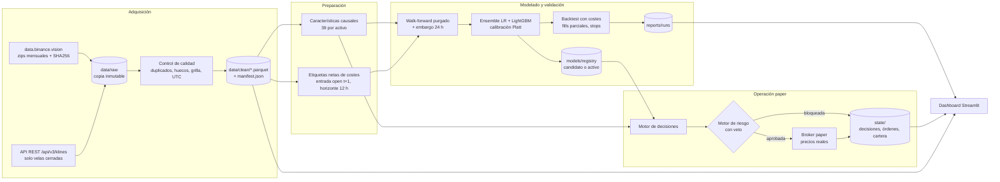
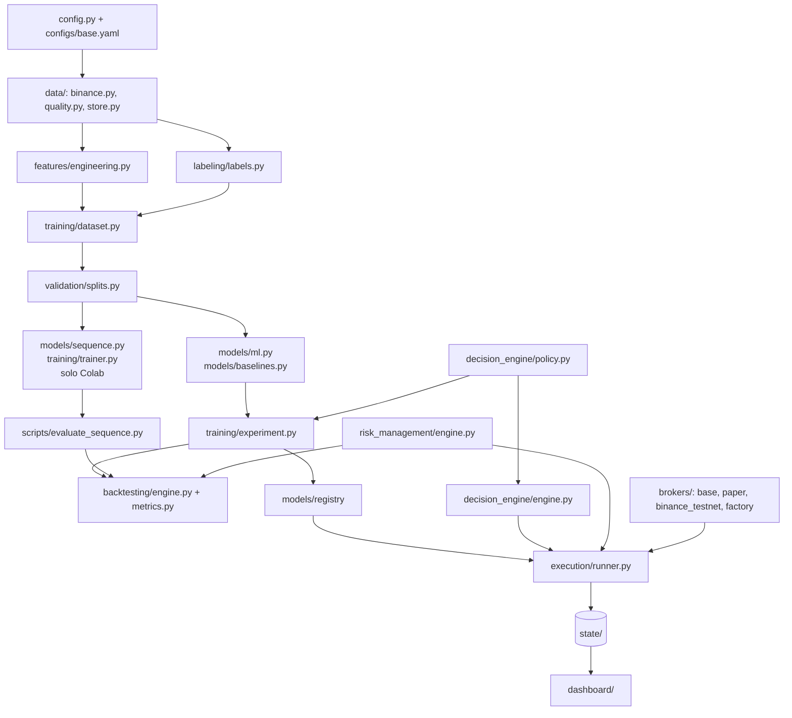
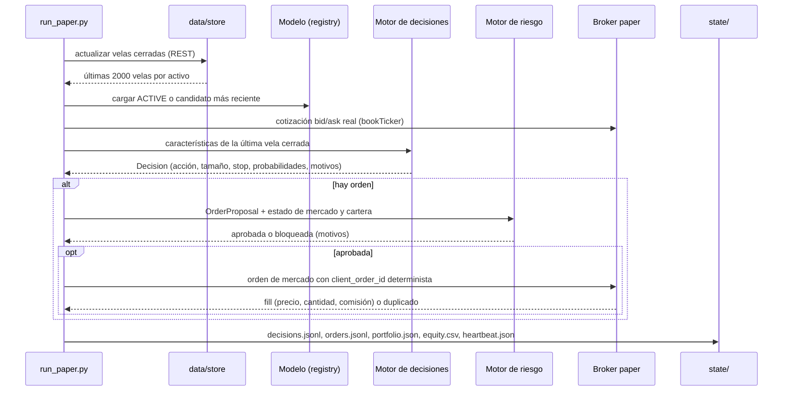
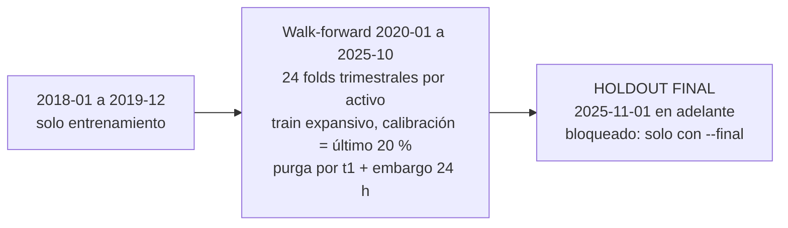
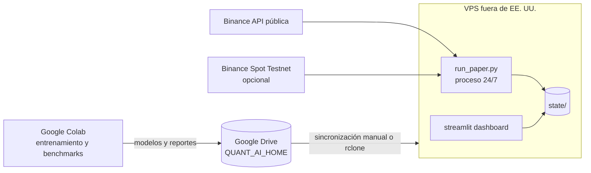

# Arquitectura de QUANT-AI

Versión MVP 0.1 (2026-11-08). Mercado: BTCUSDT y ETHUSDT spot en Binance, velas de 1 hora, posiciones long/flat sin apalancamiento. Modo por defecto: PAPER. El modo LIVE está bloqueado por código.

## 1. Flujo de datos a decisión

## 2. Mapa de módulos

La política de decisión (`decision_engine/policy.py`) es la misma en backtest y en paper. Así lo que se valida es exactamente lo que se opera.

## 3. Un ciclo de paper trading (cada hora)

El `client_order_id` tiene la forma `qa-<SIMBOLO>-<AAAAMMDDHH>-<LADO>`. Si el ciclo se repite dentro de la misma vela, la orden no se duplica.

## 4. Validación temporal

- Train de cada fold: velas con `t < inicio_test - embargo` y etiqueta resuelta (`t1`) antes de ese corte.
- Calibración: el último 20 % cronológico del train. El tramo de ajuste se purga respecto a calibración.
- Umbrales de la estrategia pre-registrados (`enter_prob 0.55`, `exit_prob 0.45`, `max_uncertainty 0.15`): no se optimizan sobre los folds.
- `build_datasets` lanza `HoldoutViolation` si aparecen datos del holdout sin `final=True`.

## 5. Modelos: entradas, salidas y dimensiones

| Componente | Entrada | Salida | Notas |
|---|---|---|---|
| Características | OHLCV + volumen agresor de la vela t y anteriores | 39 columnas por activo (31 propias, 4 de calendario, 4 del otro activo) | Rolling y EWM hacia atrás; sin normalización global |
| Etiqueta | open[t+1], open[t+13] | y ∈ {0,1}: retorno > 26 bps (costes ida y vuelta); fwd_ret; t1 | NaN si hay huecos en el horizonte |
| Regresión logística | 39 columnas, imputación por mediana, StandardScaler ajustado en el fold | p_logistic calibrada | C = 0.05 |
| LightGBM clasificador | 39 columnas (NaN nativo) | p_lightgbm calibrada | 300 árboles, 15 hojas, min_child_samples 300 |
| LightGBM regresor | 39 columnas | exp_ret (magnitud esperada, recortada a ±20 %) | Informativo, no decide |
| Ensemble | p_logistic, p_lightgbm | p_ensemble = media; uncertainty = desviación entre miembros | La incertidumbre es dispersión, no un intervalo formal |
| GRU / TCN / Transformer (Colab) | ventana (B, 64, 39) estandarizada por fold | logit → p_seq calibrada | Ver `docs/colab.md` |
| Política | p_ensemble, uncertainty, posición actual | BUY / SELL / HOLD / CLOSE y peso objetivo (0 o 0.5) | Histéresis y abstención explícita |
| Motor de riesgo | OrderProposal, MarketState, PortfolioState | aprobada / bloqueada + motivos + checks | Vender para reducir siempre se permite |

Tamaño del entrenamiento del modelo de producción actual: 54,531 velas de ajuste y 13,636 de calibración por activo (2018-01-01 a 2025-10-31).

## 6. Motor de riesgo

Controles que bloquean nueva exposición:

- kill switch (archivo `KILL_SWITCH` en la raíz) y modo emergencia (requiere limpieza manual);
- datos obsoletos (última vela cerrada hace más de 90 min);
- volatilidad horaria de 24 h por encima de 4 %;
- spread por encima de 20 bps;
- entrada fuera de distribución (3 o más características con |z| > 6 respecto al entrenamiento);
- nocional por orden mayor al 55 % del capital o mayor a 20,000 USDT;
- peso por activo mayor a 0.5 y exposición bruta mayor a 1.0 (sin apalancamiento);
- pérdida diaria de 3 % y drawdown de 15 % (este último activa el modo emergencia);
- 5 errores consecutivos de API o broker (modo emergencia);
- órdenes duplicadas (idempotencia por `client_order_id`).

## 7. Despliegue objetivo

Colab no sirve para el bot 24/7: las sesiones tienen límite de tiempo y se cortan por inactividad. El plan y los costes están en `docs/deployment.md`.
